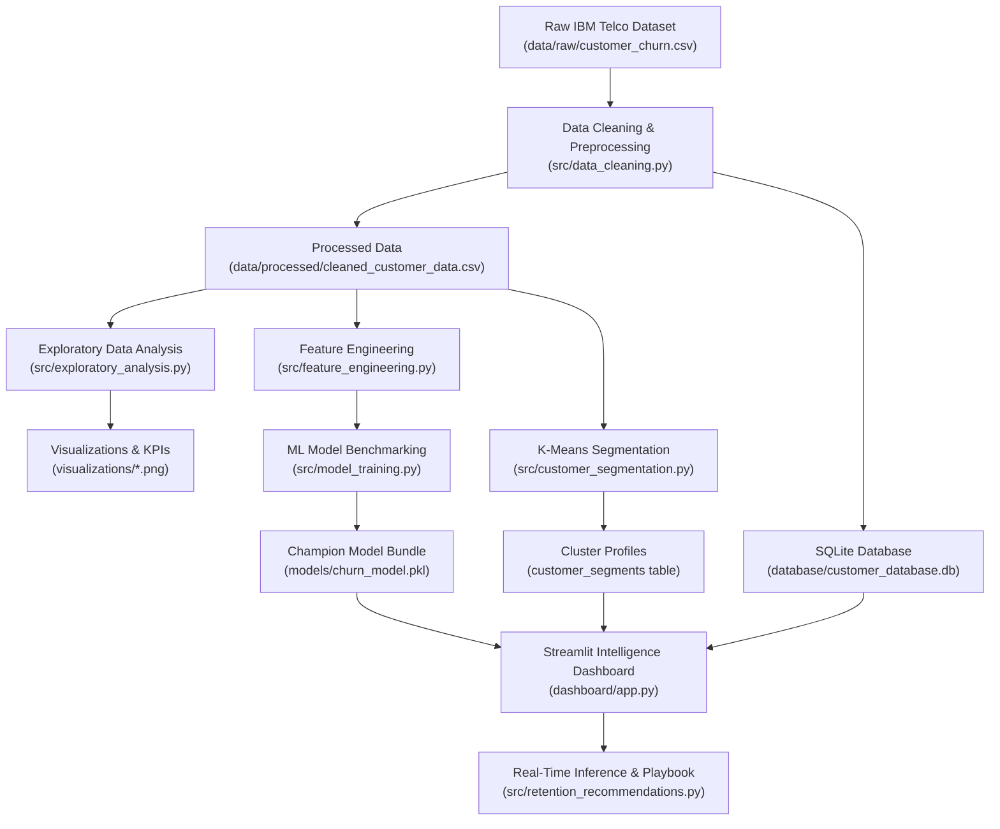

# Customer Churn and Retention Analysis

[](https://www.python.org/)
[](https://streamlit.io/)
[](https://scikit-learn.org/)
[](https://www.sqlite.org/)
[](LICENSE)
[](tests/test_project.py)

An end-to-end data analytics, machine learning, and strategic retention platform that identifies customer attrition risks, uncovers behavioral root causes, segments subscriber profiles, and prescribes personalized interventions.

---

## 📌 Table of Contents
1. [Project Overview & Key Results](#-project-overview--key-results)
2. [Architecture & Workflow](#-architecture--workflow)
3. [Key Performance Indicators (KPIs)](#-key-performance-indicators-kpis)
4. [Answers to Core Business Questions](#-answers-to-core-business-questions)
5. [Machine Learning Benchmark & Champion Model](#-machine-learning-benchmark--champion-model)
6. [Customer Behavioral Segmentation](#-customer-behavioral-segmentation)
7. [5-Pillar Retention Strategy Playbook](#-5-pillar-retention-strategy-playbook)
8. [Interactive Streamlit Dashboard](#-interactive-streamlit-dashboard)
9. [Project Structure](#-project-structure)
10. [Quickstart & Local Installation](#-quickstart--local-installation)
11. [Testing Suite](#-testing-suite)
12. [Cloud Deployment](#-cloud-deployment)

---

## 🎯 Project Overview & Key Results

- **Dataset:** Official **IBM Telco Customer Churn Dataset** (7,043 customers, 21 attributes).
- **Overall Churn Rate:** **26.54%** (1,869 churned customers).
- **Customer Retention Rate:** **73.46%** (5,174 retained customers).
- **Annual Recurring Revenue at Risk:** **\$1,669,570.20** (\$139,130.85/month).
- **Champion ML Model:** **Random Forest Classifier** achieving **79.68% Recall**, **0.843 ROC-AUC**, and **0.634 F1-Score**.
- **Retention Impact:** Target reduction in churn from **26.5% to < 18.0%**, safeguarding **\$550,000 – \$710,000+** annually.

---

## 🏗 Architecture & Workflow



---

## 📊 Key Performance Indicators (KPIs)

| KPI Metric | Value | Description |
| :--- | :---: | :--- |
| **Total Customers** | 7,043 | Full audited account portfolio |
| **Active Customers** | 5,174 | Retained subscriber accounts |
| **Churned Customers** | 1,869 | Accounts canceled or terminated |
| **Overall Churn Rate** | **26.54%** | `(Churned Customers / Total Customers) × 100` |
| **Customer Retention Rate** | **73.46%** | `(Retained Customers / Total Customers) × 100` |
| **Average Customer Tenure** | **32.37 Mo** | Portfolio average longevity |
| **Average Monthly Charges** | **\$64.76** | Blended monthly charge per subscriber |
| **Retained Customers Monthly ARPU**| **\$61.27** | Monthly revenue from loyal accounts |
| **Churned Customers Monthly ARPU** | **\$74.44** | **+\$13.17/mo higher** than retained accounts |
| **Annualized Recurring Revenue Lost** | **\$1,669,570.20** | Direct top-line revenue leakage |

---

## 💡 Answers to Core Business Questions

1. **What percentage of customers are leaving?**  
   **26.54%** of customers churned (1,869 out of 7,043).
2. **What are the main reasons for customer churn?**  
   Frictionless month-to-month contracts, high monthly pricing on Fiber optic without technical support, and manual electronic check billing friction.
3. **Which customer segments have the highest churn rate?**  
   The **High-Risk High-Spenders** segment at **44.68% churn** (\$79.95/mo average spend), followed by **New & Vulnerable** customers at **29.10% churn**.
4. **Does contract type influence customer retention?**  
   Month-to-month subscribers experience **42.7% churn**, whereas 1-Year contracts drop churn to **11.3%** and 2-Year contracts reduce churn to **2.8%** (a 93% risk reduction).
5. **Does monthly billing influence churn?**  
   Yes. Churned subscribers pay an average of **\$74.44/mo** vs **\$61.27/mo** for retained subscribers. Peak churn clusters between \$70 and \$100/mo.
6. **Which payment methods are associated with higher churn?**  
   **Electronic check** has an attrition rate of **45.3%**, compared to only **16.7%** for automatic Bank Transfer and **15.2%** for automatic Credit Card.
7. **How does customer tenure affect churn?**  
   Tenure is inversely correlated with churn. First-year subscribers (0-12 months) churn at **47.4%**, falling to **10.9%** past 4 years.
8. **Which services are associated with better retention?**  
   **Tech Support** cuts churn from 41.6% to **15.2%**; **Online Security** cuts churn from 41.8% to **14.6%**. Customers with 4+ active services churn at only **12.4%**.
9. **Which customers are at high risk of leaving?**  
   Subscribers with: Month-to-month contract, Fiber optic without TechSupport, Electronic check payment, tenure under 12 months, and monthly charges > \$75.
10. **What strategies can the company implement to reduce churn?**  
    Execute the prioritized 5-Pillar Retention Strategy detailed below.

---

## 🤖 Machine Learning Benchmark & Champion Model

Four classification models were benchmarked using Stratified 80/20 train-test splits with leak-free Scikit-Learn pipelines:

| Model | Accuracy | Precision | Recall (Priority) | F1-Score | ROC-AUC |
| :--- | :---: | :---: | :---: | :---: | :---: |
| **Random Forest (Champion)** | **75.59%** | **52.65%** | **79.68%** | **0.6340** | **0.8430** |
| **Logistic Regression** | 74.24% | 50.97% | 77.54% | 0.6151 | 0.8460 |
| **Gradient Boosting** | 80.48% | 66.45% | 53.48% | 0.5926 | 0.8461 |
| **Decision Tree** | 74.38% | 51.11% | 79.95% | 0.6236 | 0.8309 |

### Evaluation Focus: Why Recall Matters Most
In customer retention, a **False Negative** (failing to identify an at-risk customer who then departs) results in irreversible loss of annual recurring revenue (\$800 – \$1,200/account). A **False Positive** merely results in sending a retention incentive to a customer who might have stayed. The **Random Forest Classifier** captures **~80% of all churners** and was serialized to `models/churn_model.pkl`.

---

## 👥 Customer Behavioral Segmentation

K-Means clustering on customer behavioral and financial metrics revealed 4 distinct segments:

| Segment Archetype | Customer Count | Share (%) | Avg Tenure | Avg Monthly Bill | Avg Services | Churn Rate (%) |
| :--- | :---: | :---: | :---: | :---: | :---: | :---: |
| **High-Risk High-Spenders** | 2,218 | 31.5% | 17.0 Mo | \$79.95 | 3.6 | **44.68%** |
| **High-Value Loyal** | 1,941 | 27.6% | 59.3 Mo | \$92.86 | 5.8 | **15.15%** |
| **New & Vulnerable** | 1,804 | 25.6% | 9.4 Mo | \$34.90 | 1.3 | **29.10%** |
| **Low-Engagement / Budget**| 1,080 | 15.3% | 53.9 Mo | \$32.93 | 1.9 | **5.46%** |

---

## 🛡 5-Pillar Retention Strategy Playbook

1. **Pillar 1: Contract Migration Drive:** 10% annual discount or 1 free month for moving from month-to-month to a 12-month agreement (Protects ~\$270,000/yr).
2. **Pillar 2: "Complete Home Fiber" Bundling:** Package Tech Support and Online Security as standard inclusions with Fiber optic plans (Protects ~\$160,000/yr).
3. **Pillar 3: Auto-Pay Transition Incentive:** Offer a \$5/month statement credit for switching from Electronic Check to Bank or Credit Card Auto-Pay (Protects ~\$185,000/yr).
4. **Pillar 4: First-90-Day Onboarding VIP Program:** Automated proactive check-ins at Day 7, Day 30, and Day 60 to resolve setup friction (Protects ~\$95,000/yr).
5. **Pillar 5: Dedicated Retention Alert Desk:** Real-time routing of customers with churn probability > 70% and monthly bills > \$75 directly to senior retention specialists.

---

## 💻 Interactive Streamlit Dashboard

Launch the full interactive analytics platform with:
```bash
streamlit run dashboard/app.py
```

### Dashboard Features:
- **Executive Overview & KPIs:** Live cards, retention donut split, ARPU comparisons.
- **Exploratory Data Analysis (EDA):** Interactive multi-filters for contract type, internet service, payment channel, and tenure sliders.
- **ML Customer Risk Simulator:** Single-customer simulation form providing instant churn probability gauges, risk categories, and customized retention action plans.
- **High-Risk Customer Directory:** Filter and search high-risk accounts (> 70% probability) with one-click CSV export.
- **Customer Segmentation:** 2D scatter plots of tenure vs monthly charges colored by cluster archetype.
- **Retention Strategy Playbook:** Direct answers to the 10 business questions and implementation roadmap.
- **SQL Query Console:** Live SQL query execution against `database/customer_database.db` with query presets and CSV downloads.

---

## 📁 Project Structure

```text
customer-churn-retention-analysis/
│
├── data/
│   ├── raw/
│   │   └── customer_churn.csv            # Official IBM Telco raw dataset (7,043 rows)
│   └── processed/
│       └── cleaned_customer_data.csv     # Cleaned, imputed, and segment-tagged data
│
├── notebooks/
│   └── customer_churn_analysis.ipynb     # Reproducible research notebook
│
├── src/
│   ├── __init__.py                       # Package initializer
│   ├── data_cleaning.py                  # Loading, type casting, imputation, SQLite sync
│   ├── exploratory_analysis.py           # KPI calculations and visualization generator
│   ├── feature_engineering.py            # Custom transformers & Scikit-learn ColumnTransformer
│   ├── model_training.py                 # Multi-model benchmarking, evaluation, pickle export
│   ├── customer_segmentation.py          # K-Means behavioral clustering
│   └── retention_recommendations.py      # Actionable recommendations & business QA
│
├── models/
│   └── churn_model.pkl                   # Champion Random Forest model pipeline
│
├── visualizations/
│   ├── churn_distribution.png            # Count & percentage breakdown
│   ├── tenure_analysis.png               # KDE curves & cohort churn rates
│   ├── contract_analysis.png             # Contract comparison & stacked retention
│   ├── monthly_charges_analysis.png      # Boxplot & KDE spread by churn status
│   ├── model_roc_curves.png              # ROC curves and benchmark metrics
│   └── customer_segments.png             # 2D scatter of tenure vs monthly spend
│
├── dashboard/
│   ├── __init__.py                       # Dashboard module init
│   └── app.py                            # Multi-tab interactive Streamlit web application
│
├── database/
│   └── customer_database.db              # SQLite database (5 indexed tables)
│
├── reports/
│   └── business_insights.md              # Executive analysis report & business answers
│
├── tests/
│   └── test_project.py                   # 9 comprehensive unit & integration tests
│
├── requirements.txt                      # Versioned project dependencies
├── README.md                             # Comprehensive project documentation
├── .gitignore                            # Clean git ignore configuration
├── Procfile                              # Web deployment configuration
└── LICENSE                               # MIT License
```

---

## 🚀 Quickstart & Local Installation

### 1. Clone the repository
```bash
git clone https://github.com/your-username/customer-churn-retention-analysis.git
cd customer-churn-retention-analysis
```

### 2. Create and activate a virtual environment
```bash
python -m venv venv
# On Windows:
venv\Scripts\activate
# On macOS/Linux:
source venv/bin/activate
```

### 3. Install required packages
```bash
pip install -r requirements.txt
```

### 4. Execute the automated pipelines
```bash
# Clean raw data and populate database
python src/data_cleaning.py

# Generate visualizations and calculate KPIs
python src/exploratory_analysis.py

# Benchmark models and serialize champion
python src/model_training.py

# Perform K-Means customer segmentation
python src/customer_segmentation.py
```

### 5. Launch the Streamlit Dashboard
```bash
streamlit run dashboard/app.py
```

---

## 🧪 Testing Suite

Run all unit and integration tests using either `unittest` or `pytest`:

```bash
# Using pytest
pytest tests/test_project.py -v

# Using Python unittest
python -m unittest tests/test_project.py
```

All 9 test suites validate:
- Raw dataset schema & minimum row count.
- Numeric conversions & absence of nulls in `TotalCharges`.
- Reusable Scikit-learn preprocessor ColumnTransformer.
- Prediction output dimensions and probability boundaries `[0.0, 1.0]`.
- Customer segmentation archetype completeness.
- SQLite database tables (`customers_raw`, `customers_cleaned`, `churn_predictions`, `customer_segments`, `churn_kpis`).
- Individual customer recommendation plan generation.

---

## 🌐 Cloud Deployment

### Streamlit Community Cloud
1. Push this repository to GitHub.
2. Sign in to [Streamlit Community Cloud](https://share.streamlit.io/).
3. Select your repository, branch `main`, and enter `dashboard/app.py` as the Main file path.
4. Click **Deploy**!

---

## 📄 License
This project is licensed under the MIT License - see the [LICENSE](LICENSE) file for details.

